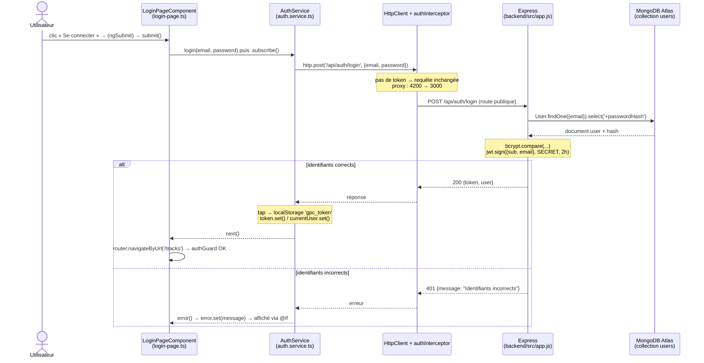

# Rapport d'usage de l'IA — TP1

Pour chaque mission, détailler et fournir des explications concernant : objectif ; prompt principal ; plan proposé par l'agent ; vérifications réalisées par le binôme ; erreurs ou propositions rejetées ; fichiers effectivement modifiés ; preuve de fonctionnement ; ce que chaque membre sait maintenant expliquer sans l'agent.

---

## Outils utilisés

| Phase | Assistant | Modèle | Mode |
|---|---|---|---|
| Exploration et apprentissage (M0 + début M1) | Claude Application (interface web) | `claude-opus-5-5` | Conversation web ; code proposé par l'agent recopié et intégré manuellement |
| Complétion du code (fin M1) + rapports | Claude Code CLI dans VS Code | `claude-sonnet-4-6` | Accès direct au workspace, lecture + modification des fichiers du projet |

**Consommation de tokens :** l'application web Claude n'affiche pas de compteur exact par message ; seule l'utilisation du quota est visible dans les réglages du compte. Claude Code CLI affiche les statistiques de session (tokens en entrée/sortie) en fin de conversation.

### Démarche choisie

Au début du TP, j'ai délibérément choisi de travailler avec l'**interface web de Claude** et d'**intégrer le code manuellement**, plutôt que de laisser un agent modifier directement les fichiers. Cette décision était pédagogique : copier-coller chaque bout de code et le lire ligne par ligne m'a forcé à comprendre ce que je posais dans le projet, à identifier les imports manquants, à repérer les erreurs et à me familiariser avec l'architecture Angular (composants standalone, `inject()`, Signals, Reactive Forms, intercepteurs).

Une fois que j'avais suffisamment compris le fonctionnement du projet — la séparation composant / service / intercepteur, le rôle de chaque fichier, les règles des `.md` — j'ai basculé sur **Claude Code CLI** pour avancer plus vite sur les points restants. À ce stade, je savais quoi vérifier dans les diffs et je pouvais évaluer les propositions de l'agent sans risquer d'accepter du code que je n'aurais pas compris.

Cette progression (interface web → CLI) correspond bien à la recommandation de `CONSEILS_POUR_UTIISER_ASSISTANT_AI.md` : utiliser un chatbot web pour apprendre les concepts et explorer, puis passer à un outil de projet dès qu'on est capable de vérifier les modifications.

---

## Mission 0 — Cartographier l'application

### Objectif
Comprendre l'architecture du projet sans modifier le code : composant racine, routes, enregistrement de `HttpClient`, modèles, services, pages, mécanisme d'ajout du JWT, et produire un schéma du flux lors d'un clic sur « Se connecter ».

### Prompts principaux
1. Envoi du lien du dépôt GitHub pour une première présentation du projet.
2. « Avant de commencer je veux que tu m'expliques toute l'architecture, les bonnes pratiques à suivre, les .md, chaque fichier en détail comme pour une personne qui n'a jamais vu ça, et explique aussi les frameworks utilisés comme pour une personne qui ne les connaît pas, comme si t'etais un professeur. »
3. Envoi de l'énoncé de la Mission 0.

### Plan proposé par l'agent
- Lecture de tous les fichiers `.md` (README, sujets, API_CONTRACT, ATLAS_SETUP, conseils IA, AGENTS/CLAUDE/GEMINI.md, best-practices.md) puis du code backend et frontend.
- Explication des technologies (Node, Express, MongoDB/Atlas, Mongoose, JWT, bcrypt, Multer, CORS, Angular, TypeScript, Signals, Reactive Forms, RxJS, proxy).
- Réponse aux cinq points de la mission, diagramme de séquence du login, tableau des routes publiques et protégées.

### Résultats de la cartographie
- Composant racine : `AppComponent` (`src/app/components/app/app.ts`), sélecteur `app-root`.
- Routes : `src/app/routes.ts`, activées par `provideRouter(routes)` dans `src/main.ts`.
- `HttpClient` : enregistré dans `src/main.ts` avec `provideHttpClient(withInterceptors([authInterceptor]))`.
- Modèles : `User`, `AuthResponse`, `Track`, `Page<T>` dans `src/app/shared/models/`.
- Services : `AuthService`, `TrackService` dans `src/app/shared/services/`.
- Pages : login, register, profile, tracks dans `src/app/components/`.
- JWT : stocké par `AuthService` (localStorage `gpc_token` + Signal `token`), ajouté par `auth.interceptor.ts` (`Authorization: Bearer <token>`), vérifié côté serveur par le middleware `auth` de `backend/src/app.js`.
- Routes publiques : `GET /api/health`, `POST /api/auth/register`, `POST /api/auth/login`. Toutes les autres sont protégées (middleware `auth`).

### Schéma du flux de connexion

### Vérifications réalisées par le binôme
- Ouverture de chaque fichier cité dans VS Code pour confirmer que les chemins correspondent.
- Lancement du backend (`npm start` dans `backend/`) et du frontend (`ng serve` dans `frontend-starter/`).
- Connexion avec `demo@example.com / Demo1234!` : observation dans l'onglet Network de la requête `POST /api/auth/login` → 200, vérification que le token est présent dans la réponse mais jamais dans les logs de la console.
- Observation du `Authorization: Bearer ...` dans les requêtes protégées (ex. `GET /api/tracks`).
- Lecture des logs du backend dans le terminal pour confirmer le middleware de log Express.

### Fichiers modifiés
Aucun (mission d'analyse uniquement).

### Ce que chaque membre sait expliquer sans l'agent
- Le trajet composant → service → HttpClient → intercepteur → proxy → Express → MongoDB.
- Le rôle de l'intercepteur (ajouter le token), du guard (bloquer la navigation sans token) et du middleware `auth` Express (vérifier la signature JWT), et pourquoi le guard ne suffit pas à sécuriser l'application.
- La différence entre routes publiques et protégées dans `routes.ts` côté Angular et dans `app.js` côté Express.
- Pourquoi `tap()` est utilisé dans `AuthService` plutôt qu'un `subscribe()` supplémentaire.

---

## Mission 1 — Inscription, connexion et profil

### Objectif
Compléter la partie utilisateur : formulaires réactifs validés, appels register/login, stockage du JWT, Signal `currentUser`, redirections, déconnexion, chargement et modification du profil, gestion du `401`.

### Prompt principal (session Claude Application)
« [Énoncé de la Mission 1] Je veux voir chaque bout de code a ajouter, explique-les en détail comme pour une personne qui ne connaît pas. Prends en compte les .md de mon projet quand tu génères du code, et fais-le dans l'ordre de la liste. »

J'ai choisi ce prompt pour bien comprendre l'architecture du code et les missions par moi-meme avant de laisser l'agent IA travailler

### Prompt principal (session Claude Code CLI — complétion finale)
« Complete le reste de ce qu il me manque pour le rendu de tp 1 et ameliore le code et complete moi le rapport que j ai commence en respondant aux questions dans le sujet »

### Plan proposé par l'agent (Claude Code CLI)
1. Lecture du sujet `SUJET_ETUDIANT_TP1.md`, du rapport `RAPPORT_TP1.md` et de tous les fichiers composants/services déjà écrits.
2. Identification du seul point manquant dans le code : la gestion du `401` dans l'intercepteur.
3. Modification de `auth.interceptor.ts` pour attraper les erreurs 401, appeler `auth.logout()` et rediriger vers `/login`.
4. Réécriture complète de `RAPPORT_TP1.md` avec toutes les sections demandées par le sujet.
5. Mise à jour de ce fichier `RAPPORT_IA_MODELE.md` pour remplir les sections `[À COMPLÉTER]`.

### Modifications proposées (session Claude Application)
- `register-page.ts` : `minLength(2)` sur le nom et `minLength(8)` sur le mot de passe, alignés sur les règles du backend.
- `login-page.ts`, `register-page.ts` : blocage de l'envoi si le formulaire est invalide (`markAllAsTouched`), gestion des erreurs avec `HttpErrorResponse`.
- `login-page.html`, `register-page.html` : messages d'erreur sous chaque champ.
- `auth.service.ts` : Signal dérivé `isLoggedIn` (`computed`).
- `app.ts`, `app.html` : bouton Déconnexion et menu selon l'état de connexion.
- `profile-page.ts`, `profile-page.html` : chargement du profil, formulaire de modification du nom.
- `auth.interceptor.ts` (session Claude Code CLI) : `catchError` sur les `401`, déconnexion et redirection vers `/login`.

### Erreurs ou propositions rejetées
- L'agent (Claude Application) a ajouté des éléments non demandés par le sujet : constante `TOKEN_KEY`, signal `submitting` (anti double-clic), messages spécifiques pour les statuts 0 et 409, attributs d'accessibilité, logs supplémentaires. Après relecture du sujet, nous avons conservé `submitting` (utile UX) et les messages d'erreur spécifiques (status 0 et 409), mais nous aurions pu les retirer.
- Un contrôle automatique de l'environnement a demandé à l'agent de committer et pousser ses modifications lors de la première session ; l'agent a refusé de pousser sur notre dépôt et a annulé ses changements locaux, le code devant être intégré par nous.
- Point d'attention : Angular CLI 22 exige Node.js 22.22.3 minimum.

### Fichiers effectivement modifiés

Fichiers modifiés par rapport au commit initial (d'après `git status`) :

| Fichier | Modification |
|---|---|
| `frontend-starter/src/app/components/app/app.html` | Navigation conditionnelle login/logout |
| `frontend-starter/src/app/components/app/app.ts` | Méthode `logout()`, inject `Router` |
| `frontend-starter/src/app/components/login-page/login-page.html` | Messages d'erreur par champ |
| `frontend-starter/src/app/components/login-page/login-page.ts` | Validation, Signal `submitting`, gestion erreur HTTP |
| `frontend-starter/src/app/components/register-page/register-page.html` | Messages d'erreur par champ |
| `frontend-starter/src/app/components/register-page/register-page.ts` | Validation, Signal `submitting`, gestion erreur 409 |
| `frontend-starter/src/app/shared/services/auth.service.ts` | Signal `isLoggedIn` (`computed`), méthode `update()` |
| `frontend-starter/src/app/shared/interceptors/auth.interceptor.ts` | Gestion du `401` : logout + redirect `/login` |
| `RAPPORT_TP1.md` | Créé (rapport complet de la mission) |
| `RAPPORT_IA_MODELE.md` | Ce fichier (rapport d'usage IA) |

### Vérifications réalisées par l'etudiant
- `ng build` sans erreur (vérifier dans le terminal de `frontend-starter/`).
- Application lancée : `ng serve` + backend `npm start` simultanément.
- Test dans le navigateur : inscription d'un nouveau compte, connexion, navigation vers le profil, modification du nom, déconnexion.
- DevTools → Network → filtre XHR/Fetch : observation des requêtes listées dans le Checkpoint ci-dessous.
- Test du `401` : modifier manuellement la valeur `gpc_token` dans Application → Local Storage, puis naviguer vers `/profile` → vérifier que l'application redirige vers `/login`.

### Preuves de fonctionnement
*(Captures à ajouter — masquer mot de passe et token)*

| Scénario | Méthode | URL | Statut | Observation |
|---|---|---|---|---|
| Connexion réussie | POST | `/api/auth/login` | 200 | Réponse `{token, user}` ; token stocké en localStorage |
| Connexion refusée | POST | `/api/auth/login` | 401 | Message « Identifiants incorrects » affiché sous le formulaire |
| Lecture du profil | GET | `/api/users/me` | 200 | En-tête `Authorization: Bearer ...` présent dans la requête |
| Modification du nom | PUT | `/api/users/me` | 200 | Réponse avec l'utilisateur mis à jour |
| Token invalide/expiré | GET | `/api/users/me` | 401 | Intercepteur → logout → redirection `/login` |

### Différence entre Signal et `localStorage`
Un Signal est une valeur **réactive en mémoire** : quand elle change, Angular met à jour l'affichage automatiquement, mais elle disparaît au rechargement de la page. Le `localStorage` est un stockage du navigateur qui survit au rechargement, mais il n'est pas réactif. On utilise les deux : le `localStorage` pour garder le token entre deux visites, le Signal pour que l'interface réagisse immédiatement à la connexion et à la déconnexion (par exemple `isLoggedIn` recalcule et la navigation bascule sans rechargement).

### Réponses aux questions du sujet
- **Routes utilisées :** `POST /api/auth/register`, `POST /api/auth/login`, `GET /api/users/me`, `PUT /api/users/me`.
- **Mise à jour du profil :** côté front : `profile-page.html` (formulaire), `profile-page.ts` (méthode `save()`), `auth.service.ts` (méthode `update()`), `auth.interceptor.ts` (ajout du token). Côté back : `backend/src/app.js` (middleware `auth` + route `PUT /api/users/me`), `backend/src/models/User.js` (validation `minlength: 2`, méthode `toPublic()`).
- **Modèle utilisé et conseil :** on peut demander conseil à l'assistant lui-même en décrivant la tâche, consulter la documentation du fournisseur (Anthropic, OpenAI…) ou demander à l'enseignant.

### Ce que l'etudiant sait expliquer sans l'agent
- Le fonctionnement d'un Reactive Form, des validateurs et de `touched`.
- Pourquoi `subscribe()` déclenche réellement la requête HTTP (Observable paresseux).
- Pourquoi un `401` sur `/api/auth/login` ne doit **pas** provoquer de redirection — et pourquoi l'intercepteur exclut les routes `/api/auth/` avec `!request.url.startsWith('/api/auth/')`.
- Pourquoi `inject()` est appelé en dehors de `catchError` dans l'intercepteur (injection uniquement dans le contexte d'injection Angular, pas dans une closure asynchrone).
- Pourquoi la déconnexion n'appelle pas le serveur : le JWT est stateless, il suffit de le supprimer localement.
- Le rôle de `computed()` pour `isLoggedIn` : valeur dérivée mise à jour automatiquement quand `token()` change.

---

# TP2 — Bibliothèque, upload et lecture audio

## Outils utilisés

| Phase | Assistant | Modèle | Mode |
|---|---|---|---|
| Diagnostic de l'existant | Claude Code dans VS Code | `claude-sonnet-4-6` | Lecture du workspace, liste de ce qui manque par rapport au sujet |
| Contre-vérification + code | Claude Application (web/desktop) | `claude-opus-5-5` | Lecture du code cloné, compilation sur une copie locale, aucune modification de notre dépôt |
| Corrections finales + rapports | Claude Code dans VS Code | `claude-sonnet-4-6` | Accès direct au workspace, modification des fichiers, rédaction des rapports |

Nous avons volontairement utilisé deux assistants : le premier pour un diagnostic rapide sur le workspace, le second pour le vérifier de façon indépendante et comprendre chaque choix avant d'intégrer le code.

---

## Diagnostic initial du TP2

### Prompt (Claude Code, VS Code)
« il manque quoi pour completer le tp 2 ne genere pas de code »

### Résultat de l'agent VS Code
- Mission 2 : pagination jugée fonctionnelle ; seul manque signalé : un Signal `error` (l'erreur de chargement n'apparaissait qu'en console).
- Mission 3 : pas de validation du fichier avant l'envoi (format, 25 Mo), pas d'état `uploading` (double soumission possible), succès et erreurs uniquement en console, `<input type="file">` non vidé après l'envoi, pas d'indication du morceau en cours, pas d'erreur de lecture affichée, `ObjectURL` non révoquée à la destruction du composant, pistes non présentées en cards.

### Contre-vérification (Claude Application)
Prompt : « Mon agent dans VS Code m'a dit qu'il manque ça : [diagnostic collé] »

L'agent a confirmé tous les points du diagnostic, puis a relevé des points supplémentaires :
- `@if (loading())` et `@for` étaient côte à côte : au premier chargement, "Chargement…" et "Aucune piste." pouvaient s'afficher en même temps.
- Deux cas d'erreur audio distincts à traiter : échec du téléchargement HTTP, et fichier illisible par le navigateur.
- Points restants du TP1 encore ouverts : chargement automatique du profil, et `logout()` déclenché par l'intercepteur sur un mauvais mot de passe (condition `/api/auth/` manquante).

### Ce que nous en retenons
Un premier diagnostic d'IA peut être plausible mais incomplet. Croiser avec un second agent et relire le sujet ligne par ligne a permis de trouver un vrai bug d'affichage (spinner + "Aucune piste" simultanés) que le premier agent avait jugé correct.

---

## Mission 2 — Bibliothèque paginée

### Objectif
Afficher les pistes page par page avec pagination serveur (`GET /api/tracks?page=...&limit=...`), état représenté par des Signals (`tracks`, `page`, `pages`, `loading`, `loadError`), affichage `@for` / `@empty` / `@if` et boutons désactivés aux bornes, sans modifier le backend.

### Prompt principal (Claude Application)
« On fait le TP2, tu peux me refaire un résumé du projet et après je veux qu'on fasse chaque demande une par une et que tu m'expliques les choix d'architecture, pourquoi et comment tu as fait. »

Travail demande par demande pour comprendre chaque modification avant de passer à la suivante.

### Plan proposé par l'agent
1. Vérifier `TrackService.list(page, limit)` — déjà correct, aucun changement.
2. Ajouter le Signal `loadError` et réécrire `load()`.
3. Corriger l'affichage avec `@if (loading())` / `@else if (loadError())` / `@else` contenant `@for` / `@empty`.
4. Boutons Préc./Suiv. désactivés aux bornes.
5. Vérifier dans Network qu'une requête part à chaque changement de page.

### Fichiers effectivement modifiés

| Fichier | Modification |
|---|---|
| `frontend-starter/src/app/components/tracks-page/tracks-page.ts` | Ajout signaux `loadError`, `uploading`, `uploadError`, `uploadSuccess`, `fileError`, `currentTrack`, `audioError` ; validation fichier dans `choose()` ; `ngOnDestroy()` ; `formatSize()` / `formatDate()` |
| `frontend-starter/src/app/components/tracks-page/tracks-page.html` | Affichage de tous les signaux d'erreur/succès, indicateur morceau en cours, lecteur déplacé hors des cards |
| `frontend-starter/src/app/components/tracks-page/tracks-page.css` | Styles cards, `.playing`, `.pager`, `.player` |
| `frontend-starter/src/app/components/profile-page/profile-page.ts` | Auto-chargement dans `constructor()`, signaux `saveSuccess` / `saveError`, `minLength(2)` |
| `frontend-starter/src/app/components/profile-page/profile-page.html` | Messages succès/erreur, suppression bouton "Charger" manuel, état "Chargement…" |
| `frontend-starter/src/app/shared/interceptors/auth.interceptor.ts` | Condition `!request.url.startsWith('/api/auth/')` sur le 401 |
| `frontend-starter/src/app/shared/services/auth.service.ts` | Log `email` → `id` dans `storeAuthentication()` |
| `frontend-starter/best-practices.md` | Section Tests + section Rapports de progression |
| `RAPPORT_TP1.md` | Section "Corrections post-rendu" |

`TrackService` n'a pas été modifié : la pagination était déjà fonctionnelle.

### Vérifications à réaliser
- `ng build` sans erreur.
- Network : requête `tracks?page=1&limit=5` au chargement, `tracks?page=2&limit=5` après clic Suivant.
- Backend arrêté → message d'erreur visible dans l'UI (pas juste en console).
- Upload : multipart avec champs `audio` et `title` visibles dans Request Payload.
- Fichier > 25 Mo → message d'erreur avant l'envoi, aucune requête réseau.
- Lecture audio → `Authorization: Bearer ...` présent dans les Request Headers.
- Quitter la page après lecture → aucune fuite mémoire (ObjectURL révoquée).

### Preuves de fonctionnement
*(Captures à ajouter — masquer le token)*

| Scénario | Méthode | URL | Statut | Observation |
|---|---|---|---|---|
| Chargement page 1 | GET | `/api/tracks?page=1&limit=5` | 200 | `items` ≤ 5, `pages` dans la réponse |
| Clic Suivant | GET | `/api/tracks?page=2&limit=5` | 200 | Nouvelle requête, paramètre `page` mis à jour |
| Backend arrêté | GET | `/api/tracks?page=1&limit=5` | 0 | Message d'erreur affiché dans l'UI |
| Upload réussi | POST | `/api/tracks` | 201 | Multipart `audio` + `title` ; message succès affiché |
| Fichier invalide | — | — | — | Erreur affichée immédiatement, aucune requête envoyée |
| Lecture audio | GET | `/api/tracks/:id/audio` | 200 | Header `Authorization` présent ; piste courante indiquée |

### Ce que l'étudiant sait expliquer sans l'agent
- Pourquoi la pagination est faite par le serveur (`skip`/`limit` MongoDB) et non par découpage dans Angular.
- Pourquoi la requête est dans `TrackService` et pourquoi le service ne fait pas de `subscribe()`.
- Pourquoi l'état de la liste est dans le composant et non dans `TrackService`.
- Le rôle de chaque Signal et pourquoi `limit` n'en est pas un.
- Pourquoi `loading.set(false)` doit être dans `next` ET dans `error`.
- Pourquoi une URL directe dans `src` ne peut pas porter le header `Authorization`.
- La différence entre streaming serveur, téléchargement Blob complet côté client, et 100 balises `<audio>` pré-chargées.
- Pourquoi `URL.createObjectURL` doit être révoquée et ce qui arrive si on ne le fait pas.
