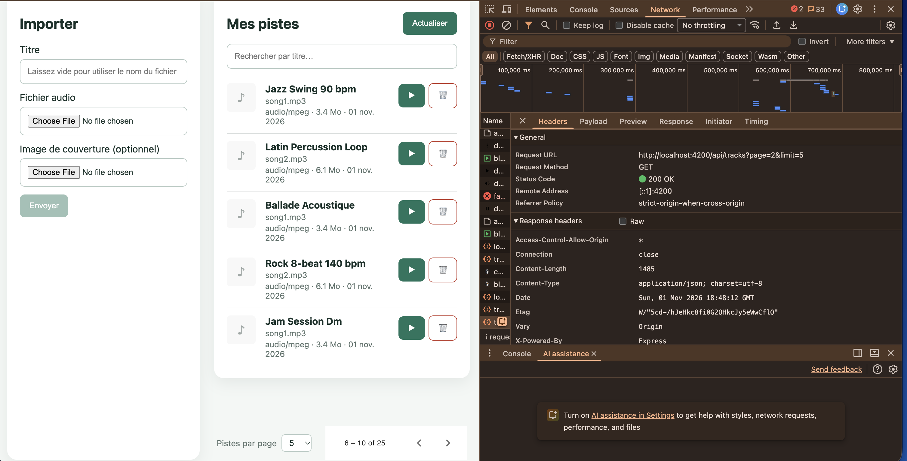
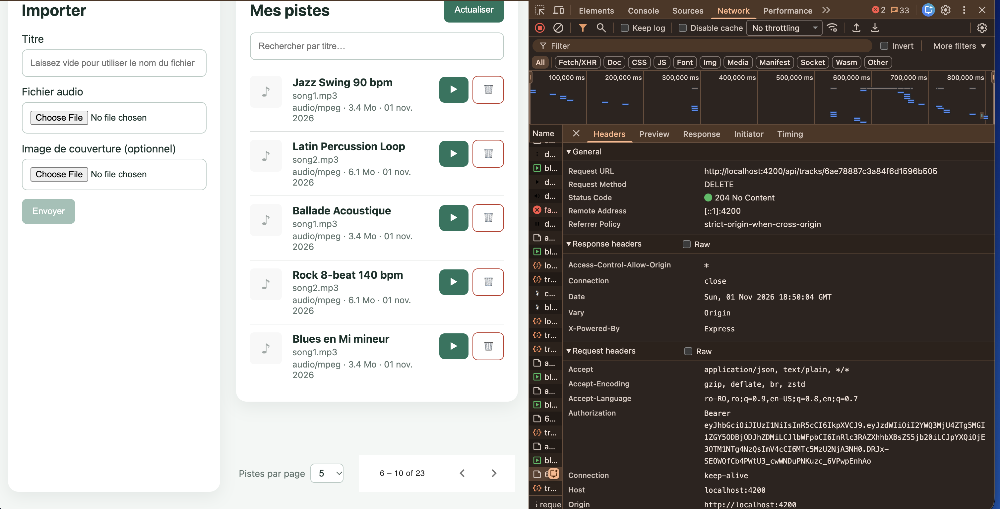
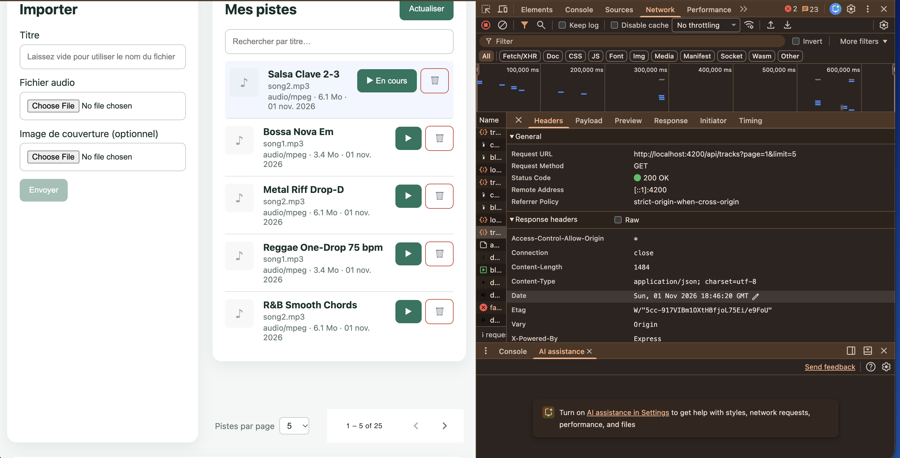
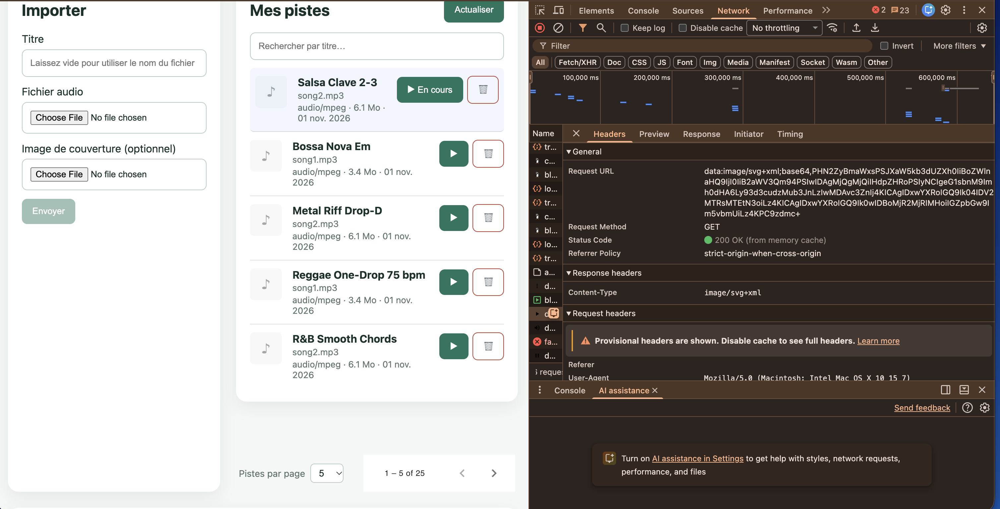

# RAPPORT TP3 — Fiabilisation et enrichissement du frontend

## Mission 5 — Suppression d'une piste

### Description

Le bouton de suppression, la confirmation en deux clics et le signal `deletingId` (anti double-clic) existaient déjà depuis TP2. Mission 5 ajoute un retour visuel via le composant Angular Material **SnackBar** : message de succès après une suppression réussie, et message d'erreur adapté au code HTTP reçu (404, 403, ou erreur générique).

### Flux

```
Utilisateur clique "Confirmer" (suppression)
  → confirmDelete(id)
    → deletingId.set(id)          ← désactive le bouton (pas de double clic)
    → TrackService.delete(id)
      → DELETE /api/tracks/:id    [JWT dans Authorization]

      ← 204 No Content
        → snackBar.open('"Titre" supprimée.', 'OK', { duration: 3000 })
        → load()                  ← recharge la liste

      ← 404 Not Found
        → snackBar.open('Cette piste n\'existe plus.', 'Fermer', { duration: 5000 })

      ← 403 Forbidden
        → snackBar.open('Vous n\'êtes pas le propriétaire.', 'Fermer', { duration: 5000 })

      ← autre erreur
        → snackBar.open('Impossible de supprimer la piste.', 'Fermer', { duration: 5000 })
```

### Explication des modifications — `tracks-page.ts`

**Imports ajoutés**

`MatSnackBar` est le service injectabe qui ouvre les notifications. `MatSnackBarModule` déclare les composants internes (overlay CDK) nécessaires pour afficher la barre. Les deux viennent de `@angular/material/snack-bar`.

**`imports: [..., MatSnackBarModule]`**

Dans un composant standalone Angular 22, `imports` liste tout ce dont le template et les services du composant ont besoin. Sans `MatSnackBarModule`, le CDK ne peut pas créer l'overlay de la notification.

**`private readonly snackBar = inject(MatSnackBar)`**

`inject()` est la façon Angular 22 d'injecter un service sans passer par le constructeur. `private readonly` parce que seul ce composant l'utilise et qu'on ne le réassigne jamais.

**`const trackTitle = this.tracks().find(t => t.id === id)?.title ?? id`**

On récupère le titre avant d'envoyer le DELETE, car après le rechargement de la liste la piste supprimée n'y sera plus. Le `?? id` est un fallback : si la piste n'est plus en mémoire (cas rare), on affiche l'id.

**`this.snackBar.open(`"${trackTitle}" supprimée.`, 'OK', { duration: 3000 })`**

`open(message, actionLabel, config)`. `duration: 3000` = la barre disparaît seule après 3 secondes. Le bouton 'OK' permet de la fermer manuellement.

**`const status: number = error?.status`**

`error` est un `HttpErrorResponse`. Son champ `status` porte le code HTTP renvoyé par le backend (404, 403, 0…).

**Ternaire `status === 404 ? ... : status === 403 ? ... : ...`**

- 404 = la piste n'existe plus (ex. supprimée dans un autre onglet).
- 403 = le backend a refusé car `track.ownerId !== req.auth.sub`.
- Autre = erreur réseau ou serveur générique.

`duration: 5000` pour les erreurs (plus long que le succès, pour laisser le temps de lire le message).

### Pourquoi le guard ne suffit pas à sécuriser la suppression

Le guard Angular (`authGuard`) vérifie uniquement que le JWT existe en `localStorage`. Il n'interroge pas le backend. Un utilisateur pourrait contourner le guard en appelant l'API directement (Postman, curl), ou utiliser un token valide mais appartenant à un autre propriétaire. C'est le backend qui sécurise réellement : le middleware `auth` vérifie la signature du JWT, puis le handler compare `track.ownerId` avec `req.auth.sub` avant d'autoriser la suppression.

### Fichiers modifiés

| Fichier | Modification |
|---|---|
| `frontend-starter/src/app/components/tracks-page/tracks-page.ts` | Import `MatSnackBar` + `MatSnackBarModule`, injection, `confirmDelete()` enrichi |

### Vérification

- `npm run build` : **OK**, 0 erreur TypeScript, 0 avertissement Angular.
- Test navigateur à réaliser : supprimer une piste → snackbar "supprimée." doit apparaître 3 s.









---

## Mission 6 — Progression de l'upload

### Description

Cette mission a été implémentée durant TP2. Le code existant couvre les quatre états demandés par le sujet : absence d'upload, upload en cours avec pourcentage, succès, et échec.

### Pourquoi un upload avec progression ne se traite pas comme une requête normale

Un appel HTTP classique (`this.http.get(...)` ou `this.http.post(...)` sans option) retourne un Observable qui n'émet **qu'une seule valeur** : la réponse finale du serveur. Il est impossible d'obtenir des informations intermédiaires sur la progression.

Pour avoir le pourcentage, il faut passer deux options :

```ts
this.http.post<Track>('/api/tracks', body, {
  reportProgress: true,  // demande au navigateur d'émettre des événements de progression
  observe: 'events',     // change le type de retour : Observable<HttpEvent<T>> au lieu de Observable<T>
})
```

Avec ces options, l'Observable émet une **séquence d'événements** :

| Événement | Contenu | Usage |
|---|---|---|
| `HttpEventType.Sent` | — | La requête a quitté le navigateur |
| `HttpEventType.UploadProgress` | `loaded`, `total` | Octets envoyés / total → pourcentage |
| `HttpEventType.Response` | `body: Track` | Réponse finale du serveur |

### Flux complet

```
upload()
  → uploading.set(true), uploadProgress.set(0)
  → TrackService.upload(file, title, cover)
    → POST /api/tracks   [reportProgress: true, observe: 'events']

    ← HttpEventType.UploadProgress  { loaded, total }
        → uploadProgress.set( Math.round(loaded/total * 100) )

    ← HttpEventType.Response  { body: Track }
        → uploading.set(false)
        → uploadSuccess.set(true)
        → load()

    ← erreur réseau / 4xx / 5xx
        → uploading.set(false)
        → uploadError.set(message)
```

### Les quatre états et leur rendu

| État | Signal(s) | Ce qui s'affiche |
|---|---|---|
| Pas d'upload | `uploading() = false` | Bouton "Envoyer" actif |
| Upload en cours | `uploading() = true`, `uploadProgress() = 0..99` | Bouton désactivé, `<progress>`, `XX %` |
| Succès | `uploadSuccess() = true` | Message vert "Piste ajoutée avec succès." |
| Échec | `uploadError() = '...'` | Message rouge avec le message du serveur |

Pendant l'envoi, le bouton est désactivé via `[disabled]="!file || uploading()"` — ce qui empêche une double soumission. Aucun token ni mot de passe n'est affiché dans la console ou l'interface.

### Fichiers concernés (implémentés en TP2)

| Fichier | Rôle |
|---|---|
| `frontend-starter/src/app/shared/services/track.service.ts` | `upload()` avec `reportProgress` et `observe: 'events'` |
| `frontend-starter/src/app/components/tracks-page/tracks-page.ts` | Gestion des événements `UploadProgress` et `Response`, signals `uploading`, `uploadProgress`, `uploadSuccess`, `uploadError` |
| `frontend-starter/src/app/components/tracks-page/tracks-page.html` | `<progress [value]="uploadProgress()" max="100">` conditionné par `@if (uploading())` |
| `frontend-starter/src/app/components/tracks-page/tracks-page.css` | Styles `.upload-progress` |

---

## Mission 7 — Tests automatisés

### 7a — Configuration vitest

Angular 22 était installé mais `ng test` n'avait pas de builder configuré. On utilise **vitest** (déjà présent en devDependency) avec **jsdom** comme environnement DOM.

#### Fichiers créés/modifiés

| Fichier | Rôle |
|---|---|
| `frontend-starter/vitest.config.ts` | Configure vitest : jsdom, globals, setupFiles, include |
| `frontend-starter/src/test-setup.ts` | Initialise TestBed Angular + polyfill localStorage workers |
| `frontend-starter/tsconfig.app.json` | Exclut les `.spec.ts` et `test-setup.ts` du build `ng build` |
| `frontend-starter/tsconfig.spec.json` | Fournit les types `vitest/globals` pour l'autocomplétion |
| `frontend-starter/package.json` | Script `test` → `vitest run` |

#### Pourquoi exclure les spec files du build

Sans exclusion, `ng build` essaie de compiler les `.spec.ts`. Ces fichiers utilisent `describe`, `it`, `expect` qui sont des globals vitest — TypeScript ne les connaît pas et produit `TS2304: Cannot find name 'it'`. On les exclut du `tsconfig.app.json` et on leur donne leur propre `tsconfig.spec.json` avec `"types": ["vitest/globals"]`.

#### Pourquoi le polyfill localStorage

Dans les workers vitest avec Node.js 22, `globalThis.localStorage` est `undefined` (le localStorage expérimental de Node nécessite `--localstorage-file`). `AuthService` appelle `localStorage.getItem('gpc_token')` à sa création → crash sans le polyfill. On définit un objet `Storage` en mémoire via `Object.defineProperty` uniquement si `localStorage` est absent.

---

### 7b — Tests frontend (9 tests, 4 fichiers)

Aucun test ne dépend d'un backend ou de MongoDB : `HttpTestingController` intercepte les requêtes avant qu'elles partent sur le réseau et simule les réponses en mémoire.

#### `auth.service.spec.ts`

| Test | Ce qui est vérifié |
|---|---|
| `login()` envoie POST /api/auth/login avec email et mot de passe | URL, méthode HTTP, corps exact `{ email, password }` |
| `login()` stocke le token reçu dans le signal `token()` | signal mis à jour après `req.flush(...)` |

Points clés :
- `provideZonelessChangeDetection()` obligatoire car l'app n'utilise pas zone.js.
- `httpMock.expectOne('/api/auth/login')` échoue si zéro ou plusieurs requêtes sont émises vers cette URL.
- `httpMock.verify()` dans `afterEach` vérifie qu'aucune requête n'est restée sans réponse.

#### `track.service.spec.ts`

| Test | Ce qui est vérifié |
|---|---|
| `list()` transmet page et limit en paramètres de requête | `params.get('page') === '2'`, `params.get('limit') === '10'` |
| `list()` transmet search quand fourni | `params.get('search') === 'blues'` |
| `delete()` envoie DELETE /api/tracks/:id | méthode et URL exactes |

Point clé : `httpMock.expectOne(r => r.url === '/api/tracks')` utilise un prédicat car les query params sont séparés de l'URL dans `HttpRequest` — l'URL seule ne contient pas `?page=2&limit=10`.

#### `auth.interceptor.spec.ts`

| Test | Ce qui est vérifié |
|---|---|
| Ajoute `Authorization: Bearer <token>` quand token présent | header présent et correct sur la requête interceptée |
| N'ajoute pas Authorization sans token | `headers.get('Authorization') === null` |

Point clé : `provideHttpClient(withInterceptors([authInterceptor]))` enregistre l'intercepteur dans le TestBed — les requêtes passent par lui avant d'être capturées par `HttpTestingController`. `provideRouter([])` est nécessaire car l'intercepteur injecte `Router`.

#### `auth.guard.spec.ts`

| Test | Ce qui est vérifié |
|---|---|
| Redirige vers /login sans token | `result instanceof UrlTree` |
| Autorise l'accès avec token | `result === true` |

Point clé : `TestBed.runInInjectionContext(() => authGuard(...))` est nécessaire car `authGuard` est une `CanActivateFn` qui utilise `inject()` en interne — `inject()` ne fonctionne que dans un contexte d'injection Angular.

#### Résultat

```
Test Files  4 passed (4)
Tests       9 passed (9)
Duration    ~850 ms
```

---

### 7c — Extension backend : tests de contrat (4 nouveaux tests)

Ajoutés à `backend/test/api.test.js`. Tous fonctionnent sans MongoDB.

#### Fichiers modifiés

| Fichier | Modification |
|---|---|
| `backend/test/api.test.js` | Import `jwt`, fonction `makeToken()`, 4 nouveaux tests |

#### Les tests

| Test | Attendu | Pourquoi sans MongoDB |
|---|---|---|
| `GET /api/tracks` sans JWT | 401 | `auth()` rejette avant toute requête Mongoose |
| `GET /api/tracks` avec JWT invalide | 401 | `jwt.verify()` échoue → catch → 401 |
| `POST /api/tracks` sans fichier audio | 400 | Handler vérifie `req.files?.audio?.[0]` avant MongoDB |
| `POST /api/tracks` avec MIME non autorisé | 400 | `fileFilter` rejette → gestionnaire d'erreurs → 400 |

`makeToken()` génère un JWT signé avec `'tp1-development-secret'` (secret de développement de `app.js`) pour passer le middleware `auth()` dans les tests qui en ont besoin.

#### Résultat

```
tests 6  |  pass 6  |  fail 0
```

---

## Captures DevTools

### Suppression (Mission 5)


### Pagination


---

## Vérifications finales

- `npm test` (frontend) : **9/9 tests passent**
- `npm test` (backend) : **6/6 tests passent**
- `npm run build` (frontend) : **OK**, 0 erreur TypeScript, 0 avertissement Angular

---

## Rapport des tests — résultats attendus et observés

### Tests frontend (vitest)

| Fichier | Test | Résultat attendu | Résultat observé |
|---|---|---|---|
| `auth.service.spec.ts` | `login()` envoie POST /api/auth/login avec email et mot de passe | POST vers `/api/auth/login`, corps `{ email, password }` | ✅ Passé |
| `auth.service.spec.ts` | `login()` stocke le token reçu dans le signal `token()` | `service.token()` vaut `'jwt_token'` après flush | ✅ Passé |
| `track.service.spec.ts` | `list()` transmet page et limit | params `page=2`, `limit=10` présents | ✅ Passé |
| `track.service.spec.ts` | `list()` transmet search quand fourni | param `search=blues` présent | ✅ Passé |
| `track.service.spec.ts` | `delete()` envoie DELETE /api/tracks/:id | méthode DELETE, URL `/api/tracks/abc123` | ✅ Passé |
| `auth.interceptor.spec.ts` | Ajoute Authorization quand token présent | header `Authorization: Bearer test_jwt_token` | ✅ Passé |
| `auth.interceptor.spec.ts` | N'ajoute pas Authorization sans token | header `Authorization` absent (null) | ✅ Passé |
| `auth.guard.spec.ts` | Redirige vers /login sans token | résultat `instanceof UrlTree` | ✅ Passé |
| `auth.guard.spec.ts` | Autorise l'accès avec token | résultat `=== true` | ✅ Passé |

### Tests backend (node:test)

| Test | Résultat attendu | Résultat observé |
|---|---|---|
| Health check | 200 `{ status: "ok" }` | ✅ Passé |
| Schémas Mongoose | email lowercase, ref `"User"` | ✅ Passé |
| GET /api/tracks sans JWT | 401 avec `message` | ✅ Passé |
| GET /api/tracks avec JWT invalide | 401 | ✅ Passé |
| POST /api/tracks sans fichier audio | 400 avec `message` | ✅ Passé |
| POST /api/tracks avec MIME non autorisé | 400 | ✅ Passé |

---

## Restitution orale — réponses aux 6 questions

**1. Pourquoi la suppression passe par un service ?**
Le composant gère uniquement l'interface (confirmation, SnackBar, état `deletingId`). Le service encapsule la logique HTTP (`DELETE /api/tracks/:id`). Cette séparation permet de tester le service indépendamment du composant et de réutiliser la même méthode depuis plusieurs endroits sans dupliquer l'URL.

**2. Comment le backend protège la suppression ?**
Deux niveaux : (1) le middleware `auth()` vérifie la signature du JWT et en extrait `req.auth.sub` — si absent ou invalide, 401 immédiat ; (2) le handler charge la piste en base et compare `track.ownerId.toString()` avec `req.auth.sub` — si différent, 403. Le frontend ne peut pas contourner ces vérifications en appelant l'API directement.

**3. Comment Angular calcule le pourcentage d'upload ?**
Avec `reportProgress: true` et `observe: 'events'`, Angular active les événements de progression sur le `XMLHttpRequest` sous-jacent. Le navigateur émet des événements `HttpEventType.UploadProgress` contenant `loaded` (octets envoyés) et `total` (taille totale). Le pourcentage est `Math.round(loaded / total * 100)`.

**4. Pourquoi les tests HTTP n'ont pas besoin de MongoDB ?**
`HttpTestingController` intercepte les requêtes HTTP avant qu'elles partent sur le réseau. Il les met en attente, permet de les inspecter (URL, méthode, headers, body) et de simuler une réponse avec `req.flush(...)`. Ni Express ni MongoDB ne démarrent — tout se passe en mémoire dans le processus de test.

**5. Ce que vérifie un test d'intercepteur ou de guard ?**
- **Intercepteur** : on envoie une requête via `HttpClient` (qui passe par l'intercepteur), puis on inspecte les headers de la requête interceptée. On vérifie que `Authorization: Bearer <token>` est présent quand un token existe et absent sinon.
- **Guard** : on appelle la fonction `authGuard()` dans un contexte d'injection (`TestBed.runInInjectionContext`). On vérifie qu'elle retourne `true` avec un token valide et un `UrlTree` vers `/login` sans token.

**6. Différence entre test unitaire et test d'intégration ?**
- **Unitaire** : un seul service ou fonction isolé, toutes les dépendances sont des mocks. Ex : `TrackService.delete()` ne teste que la formation de la requête HTTP, sans serveur.
- **Intégration** : plusieurs couches réelles collaborent. Ex : les tests backend démarrent un vrai serveur Express et envoient de vraies requêtes HTTP via `fetch` — ils testent la chaîne complète `routeur → middleware → handler` sans avoir besoin de MongoDB pour les cas testés.
